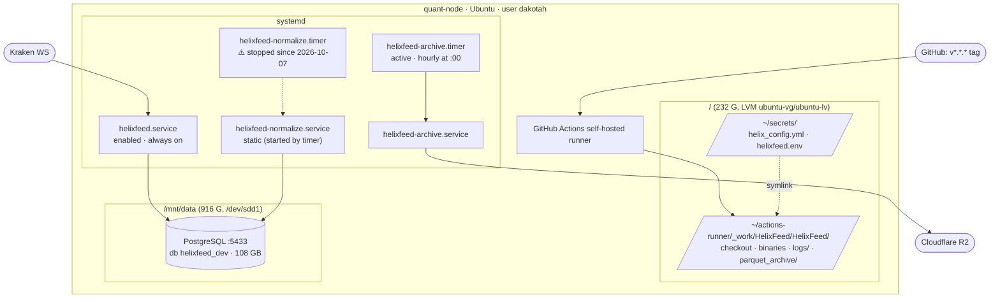

# Production: How HelixFeed Is Running on `quant-node`

The record of the **real** deployment: which machine, which paths, which ports, what's
on, what's off, and what's happened to it. [operations.md](operations.md) explains *how*
to deploy and debug in general. This file says *what is actually there*.

> **Last verified: 2026-10-09**, by running commands on the server during the v1.2.0
> rollout. Every fact below says how it was confirmed. Things marked ❓ were never
> checked directly. Re-run the [verification block](#re-verify-this-document) whenever
> you come back to this file, and update the date.

## At a glance



## The machine

| Item | Value | How we know |
|---|---|---|
| Hostname | `quant-node` | shell prompt |
| OS | Ubuntu (systemd + journald) | `systemctl`/`journalctl` output |
| Service user | `dakotah` (uid 1000) | `/run/user/1000`, prompt |
| Role | runs HelixFeed **and** the GitHub Actions self-hosted runner that builds it | `deploy.yml`, binary path |

### Disks (`df -h`, 2026-10-09)

| Mount | Device | Size | Used then | What lives there |
|---|---|---|---|---|
| `/` | `/dev/mapper/ubuntu--vg-ubuntu--lv` | 232 G | 16 G (8%) | OS, the checkout, `logs/`, `parquet_archive/`, `~/secrets` |
| `/mnt/data` | `/dev/sdd1` | 916 G | 109 G (13%) | almost certainly Postgres (the 109 G matches the DB size) ❓ not confirmed with `SHOW data_directory` |
| `/boot` | `/dev/sda2` | 2 G | 14% | kernel |

⚠️ The **Parquet staging area is on `/`, the smaller disk.** A large normalize run writes
its Parquet files there before the archiver uploads and deletes them.

## The database

| Item | Value | How we know |
|---|---|---|
| Server | PostgreSQL on `localhost`, **port 5433** (not the default 5432) | psql only connected with `-p 5433` |
| Database | `helixfeed_dev` | psql commands that worked |
| User | `helixfeed` (password in the server config) | same |
| Size | **108 GB** on 2026-10-09 | `pg_database_size` |
| Schema | all migrations through `20261006120000_bigint_ids` (every `id` is `bigint`) | `information_schema.columns`, 2026-10-09 |
| Migration tracking | ❓ unknown whether `_sqlx_migrations` is up to date. The bigint migration was applied with `psql -f`, which doesn't record it there. | |

⚠️ **The production database is called `helixfeed_dev`.** The name is misleading, but
it's the live data. On the server, **never run `cargo test`**: the Postgres tests insert
and delete rows and run migrations against a database called `helixfeed_dev`. (They
target port 5432, so they'd only hit it if something listens there, but don't find out
the hard way.)

Connect:

```bash
psql -h localhost -p 5433 -U helixfeed -d helixfeed_dev
```

## The code and config

| Item | Value | How we know |
|---|---|---|
| Checkout / working directory | `/home/dakotah/actions-runner/_work/HelixFeed/HelixFeed` | `systemctl status` CGroup line |
| Running binary | `…/target/release/helix_feed` | same |
| Deployed version | **v1.2.0** (commit `a3ff8cb`) | CI run 2026-10-07 03:29 UTC; tag on that commit |
| Config | `helix_config.yml` in the checkout, a **symlink** to the central `~/secrets/helix_config.yml` | unit files' `ExecStartPre`; confirmed "centralized" by Dakotah |
| Secrets | `~/secrets/helixfeed.env` via `EnvironmentFile=` | unit files |
| Feed log | `…/logs/kraken.log` | `system.log` path; config |
| System log | `…/logs/system.log` | read on 2026-10-09 |

`Cargo.toml` still says `1.1.2`: the version bump was skipped for v1.2.0. The git tag is
the source of truth for what's deployed.

### Configured pipelines (6)

Seen in `system.log` on 2026-10-09: two symbols × three feed types.

| | trades | book | orders (L3) |
|---|---|---|---|
| BTC/USD | ✅ | ✅ | ✅ |
| ETC/USD | ✅ | ✅ | ✅ |

## The services

| Unit | State (2026-10-09) | Schedule | Notes |
|---|---|---|---|
| `helixfeed.service` | **enabled, active** | always on | loaded from `/etc/systemd/system/helixfeed.service`; restarted by hand ~17:15 UTC on 2026-10-09 after the outage below |
| `helixfeed-normalize.timer` | ⚠️ **stopped** | hourly | stopped on purpose before the v1.2.0 deploy and **not re-enabled** as of 2026-10-09 |
| `helixfeed-normalize.service` | `static` | via its timer | last run 2026-10-07 03:00 UTC ("processed 0 rows") |
| `helixfeed-archive.timer` | active | hourly at :00 | enabled by CI on every deploy |
| `helixfeed-archive.service` | runs hourly | via its timer | last real upload logged 2026-09-24 11:01; since then it has had nothing to upload |

Normal resource use of the daemon: **~110 MB RAM, 5 threads**, about 40 min of CPU per
day (`systemctl status`, 2026-10-09).

## Throughput and growth

From the raw-table backlog on 2026-10-09 (everything since the v1.2.0 start at
2026-10-07 03:30 UTC, about 58 hours):

| data_type | rows | share |
|---|---|---|
| book | 28 478 156 | 49.8% |
| orders | 28 489 975 | 49.8% |
| trades | 194 726 | 0.3% |
| **total** | **≈ 57.2 M** | ≈ **270 messages/second** |

Rule of thumb: **≈ 40 GB/day of raw data** goes into Postgres. With the normalizer off,
nothing drains it, so `/mnt/data` (761 G free on 2026-10-09) would fill in roughly **19
days** from that date. Check the [current state](#re-verify-this-document) first thing.

## How to tell it's actually working

**`systemctl status` showing `active` is not enough.** On 2026-10-09 it said `active`
for four hours while nothing was being collected. A healthy system passes all four
checks:

| # | Check | Command | Healthy looks like |
|---|---|---|---|
| 1 | Process alive | `systemctl status helixfeed` | `active (running)` |
| 2 | **Data fresh** | the SQL below | `behind` is a few seconds for all three types |
| 3 | Both timers on | `systemctl list-timers 'helixfeed-*'` | **two** timers listed |
| 4 | No give-ups | `grep -E "ERROR\|feed channel closed" logs/system.log \| tail` | nothing recent |

```sql
SELECT data_type, max(received), now() - max(received) AS behind
FROM raw_financial_data GROUP BY 1;
```

Check 2 is the one that matters. It's the only check that proves data is arriving.

## Incident log

### 2026-10-09 · all feeds stopped for ~3¾ hours

| Time (UTC) | Event |
|---|---|
| ~13:27:00 | last row written for all three data types |
| 13:28:16 | all six pipelines log `feed channel closed (WS task exited)` in the same second |
| 13:28 → ~17:15 | daemon process still `active`, collecting nothing |
| ~17:12 | spotted while checking the v1.2.0 rollout (`max(received)` stuck at 13:27) |
| ~17:15 | `sudo systemctl restart helixfeed` → collection resumed |

**Cause:** every feed hit `max_reconnect_attempts` consecutive failed connects at the same
moment, most likely a short network/DNS/Kraken outage. A feed that runs out of attempts
**stops for good**, and nothing restarts it. ❓ The exact connect error was never pulled
from `kraken.log`. Get it with:

```bash
grep "2026-10-09 13:2" ~/actions-runner/_work/HelixFeed/HelixFeed/logs/kraken.log | grep -i -E "fail|error|max"
```

**Data lost:** everything Kraken sent between 13:27 and ~17:15.
**Real fix (open):** a short outage must not end collection. Either retry forever with
growing delays, or exit the process when every feed is dead so systemd restarts it.
Undecided, see [Open issues](#open-issues).

### 2026-09-24 → 2026-10-07 · nothing collected (suspected)

Every hourly normalize run in that window reported **0 raw rows** for all types, and
`system.log` has no entries between 2026-09-24 11:01 and 2026-10-09. So the old daemon
(v1.1.x) was very likely collecting nothing. ❓ The cause is not confirmed; check
`kraken.log` for that period if it matters.

### 2026-10-07 · v1.2.0 deploy

Stopped the normalize timer → pushed tag `v1.2.0` (CI build 03:29, daemon up 03:30:17) →
applied `20261006120000_bigint_ids` with `psql -p 5433 -f` (confirmed 2026-10-09). The old
daemon was killed instantly at the restart (it had no graceful shutdown); every restart
after that one flushes buffers first.

## Open issues

In priority order, as of 2026-10-09:

1. **Normalize timer is still off** and the raw backlog was 57 M rows / 108 GB and growing.
   Drain it in a controlled way. The Parquet output lands on `/` (204 G free then), so
   watch `df -h` while it runs, then `sudo systemctl enable --now helixfeed-normalize.timer`.
2. **Feeds give up permanently after a short outage** (see the 2026-10-09 incident). A
   design decision for the reconnect logic.
3. **No alerting.** The outage was found by luck. Even a cron job that runs check 2 and
   emails when `behind > 5 min` would have caught it in minutes.
4. `_sqlx_migrations` may not reflect the bigint migration (see the database section).
5. Bump `Cargo.toml` to match the deployed tag.

## Re-verify this document

Run this on the server and update anything that changed, plus the "Last verified" date
at the top:

```bash
hostname; df -h / /mnt/data
```

```bash
systemctl status helixfeed --no-pager | head -12
```

```bash
systemctl list-timers --all 'helixfeed-*' --no-pager
```

```bash
readlink -f ~/actions-runner/_work/HelixFeed/HelixFeed/helix_config.yml
```

```bash
psql -h localhost -p 5433 -U helixfeed -d helixfeed_dev -c "SELECT pg_size_pretty(pg_database_size('helixfeed_dev'));" -c "SELECT data_type, count(*), now() - max(received) AS behind FROM raw_financial_data GROUP BY 1;"
```

```bash
sudo -u postgres psql -p 5433 -c "SHOW data_directory;"
```

```bash
tail -20 ~/actions-runner/_work/HelixFeed/HelixFeed/logs/system.log
```
